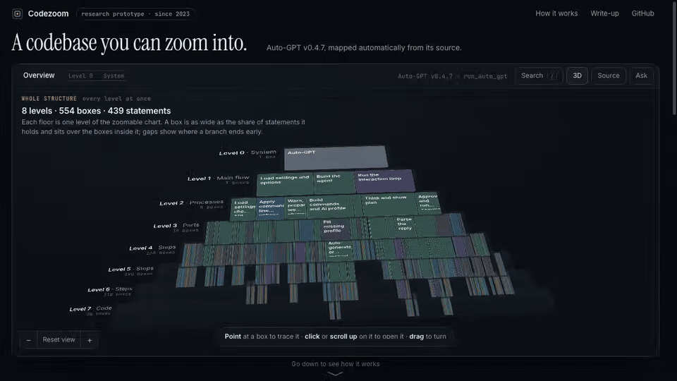

# Codezoom

**A codebase you can zoom into.** Codezoom reads a Python repository and draws it as one
flowchart you can zoom through: the whole program as a single box at the top, its phases
and processes below, and every branch and statement at the bottom. Each box can be
asked about.



**Live demo:** <https://codezoom.junbot.dev> · **Write-up:**
<https://www.junbot.dev/article/repo-understanding-tool>

The demo maps Auto-GPT v0.4.7 from its command-line entry point, `run_auto_gpt`. Nothing in
it was drawn by hand.

## What you can do in the demo

- **See the whole structure.** The page opens on a pyramid: one floor per level, from the
  program (level 0) down to code (level 7). A box is as wide as the share of statements it
  holds and sits over the boxes inside it, so you can see where the program is deep and
  where it is shallow. Point at a box to trace it up and down.
- **Zoom in.** Scroll up on a box, or click it, to open it in the zoomable chart.
  Scrolling up on a box there zooms into it, and its inner chart grows out of it. A
  caption names each level: system, main flow, processes, parts, steps, code. Scrolling
  out past the top returns to the pyramid.
- **Ask.** Click a box to read its code and ask about it. Answers move the diagram: they
  zoom to the right level, select the step, and light up the execution path they describe.
- **Jump.** Press `/` to search for any step, function or line of code.

The live site is static and needs no key: answers are pre-computed. An optional live
mode, with the key kept on the server, is described in [demo/README.md](demo/README.md).

## How it works

For one entry point of a Python program:

1. **Call graph.** [PyCG](https://github.com/vitsalis/PyCG) finds every function the run
   can reach. `codebase_analyzer/parser/` merges the call graph with the definition tree
   (package → module → class → function) into `codeinfo.json`.
2. **Syntax-tree flowcharts.** `codebase_analyzer/flowchart/ast_process.py` turns each
   function's syntax tree into start, action, call, decision and end nodes, nested the way
   the code is, and `flowchart/link.py` attaches each callee's chart to its call node.
3. **Labels.** A language model writes one plain-English line per step. The 2026 pass
   (`codezoom/relabel.py`) rewrites them with the whole function's source in view, so a
   label says what a step is for, not just what its syntax is.
4. **Rebalancing.** Straight from the syntax tree, the chart is deep and thin: 21 levels
   at its deepest, with most charts holding one or two steps. `codezoom/retree.py` expands
   thin levels and groups long runs of steps into named blocks. Each block has one way in
   and one way out, so it can be drawn as a single box. A language model proposes and
   names the groups, and a dynamic-programming segmenter takes over when its answer breaks
   that rule. The result is 7 levels, with 81% of charts showing 3 to 8 steps. Method and
   comparisons are in [docs/abstraction.md](docs/abstraction.md).
5. **Agents.** `codebase_analyzer/bots/` has one question-answering agent per level
   (repository, package, module, function). Each answers from its own summaries and can
   ask the level below.

What is generated, what is cached model output and what is hand-written is listed in
[demo/NOTES.md](demo/NOTES.md).

## Run it locally

```bash
cd demo
npm install
npm run dev
```

To rebuild the diagram data from the 2023 dumps (Python 3.10+, standard library only):

```bash
python3 -m codezoom.export       # writes demo/src/data/graph.json from the cached model answers
python3 -m pytest tests          # rebalancing is lossless, deterministic and valid
```

## Repository

```
codezoom/          2026: loader, relabel and rebalancing passes, exporter, model-answer cache
demo/              the demo site (Vite, React, TypeScript)
docs/              the plan and the write-up of the abstraction work
tests/             tests for codezoom
codebase_analyzer/ 2023 pipeline
  parser/            call graph + definition tree → codeinfo.json
  flowchart/         syntax tree → flowchart nodes, labels, linking
  bots/              repository, package, module and function agents
convert_dump/      linked flowchart of Auto-GPT's run_auto_gpt (input to the demo)
shared_cache/      cached codeinfo and call graphs from the 2023 runs
third_party/PyCG   call-graph generator (git submodule)
```

## The 2023 pipeline

Codezoom started in 2023 as a research prototype. Its Python CLI is kept as it was and is
not needed for the demo. It was built against mid-2023 dependencies (Poetry 1.5, Python
3.10, PyCG, pygraphviz and the LLM client libraries of that time), so expect to pin old
versions; `pyproject.toml` and `poetry.lock` record the exact set. Clone with
`--recurse-submodules` to get PyCG. The CLI reads its model key from `.env` and its
settings from `config.yaml`. Both are git-ignored, and `.env.example` and
`config.yaml.example` are the templates.

## License

See [LICENSE](LICENSE). Auto-GPT is MIT-licensed; the code excerpts shown in the demo
belong to its contributors.
