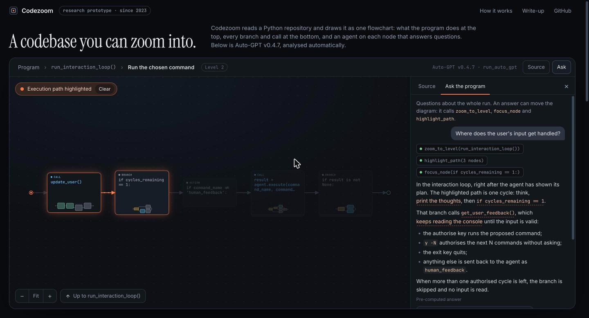

# Codezoom

**A codebase you can zoom into.** Codezoom reads a Python repository and draws it
as one hierarchical flowchart: what the program does at the top, every branch and call
at the bottom. A hierarchy of agents answers questions about the code at each level.

> **Status:** started in 2023 as the research prototype Ichigen Coder; the demo and the abstraction work are from 2026.
> **Demo:** _link to be added once deployed on junbot.dev_ · **Write-up:** <https://www.junbot.dev/article/repo-understanding-tool>



The demo shows Auto-GPT v0.4.7, analysed from its CLI entry point. Click a step to read
its code and ask about it; double-click or scroll to zoom in. Answers can move the
diagram to the place they talk about.

## Run the demo

```bash
cd demo
npm install
npm run dev
```

It is a static site with pre-computed answers, so it needs no key. Build, deploy and
the optional live mode are covered in [demo/README.md](demo/README.md). What is
generated and what is hand-written is in [demo/NOTES.md](demo/NOTES.md). Where the
project is going is in [docs/PLAN.md](docs/PLAN.md).

## How it works

For one entry point of a Python program:

1. **Call graph.** [PyCG](https://github.com/vitsalis/PyCG) builds the call graph from
   the entry point. `codebase_analyzer/parser/` merges it with the definition tree
   (package → module → class → function) into `codeinfo.json`.
2. **Syntax-tree flowcharts.** `codebase_analyzer/flowchart/ast_process.py` walks each
   function's syntax tree into start, action, call, decision and end nodes, nested the
   way the code is. `if`, `for`, `while`, `try` and `with` each have their own shape.
3. **Labels.** `flowchart/label.py` has a language model write one plain-English line
   per statement, then summarises each block from the labels inside it.
4. **Linking.** `flowchart/link.py` attaches the callee's chart to each call node, which
   is what makes zooming from a call into its function possible.
5. **Rebalancing.** The syntax-shaped tree is deep and thin: most charts hold one or two
   steps, a few hold twenty. `codezoom/retree.py` expands thin levels and groups long
   runs of steps into named blocks, so every level shows a handful of steps. A language
   model proposes and names the groups; a dynamic-programming segmenter is the fallback.
   The 2023 attempt at this (`flowchart/customized_louvain.py`, community detection) is
   one of the baselines it is compared against in [docs/abstraction.md](docs/abstraction.md).
6. **Agents.** `codebase_analyzer/bots/` has one question-answering agent per level:
   repository, package, module, function. Each answers from its own summaries and can
   ask the level below.

```
codebase_analyzer/
  parser/      call graph + definition tree → codeinfo.json
  flowchart/   syntax tree → flowchart nodes, labels, linking, clustering
  bots/        repo, package, module and function agents
  tools/       embedding search and bot-to-bot tools
codezoom/      2026: loader, rebalancing pass, grouping experiments, exporter (stdlib Python)
tests/         tests for codezoom
docs/          the plan, and the write-up of the abstraction work
convert_dump/  linked flowchart of Auto-GPT's run_auto_gpt (demo input)
shared_cache/  cached codeinfo and call graph for Auto-GPT v0.4.7
demo/          the demo site
```

## Running the 2023 pipeline

The Python CLI is kept as it was and is not needed for the demo. It was built against
mid-2023 versions of its dependencies (Poetry 1.5, Python 3.10, PyCG, pygraphviz and
the LLM client libraries of that time) and has not been updated since, so expect to pin
old versions to run it. `pyproject.toml` and `poetry.lock` record the exact set. It reads
its model key from `.env` and its settings from `config.yaml`; both are git-ignored, with
`.env.example` and `config.yaml.example` as templates.

## License

See [LICENSE](LICENSE). Auto-GPT is MIT-licensed; the code excerpts shown in the demo
belong to its contributors.
